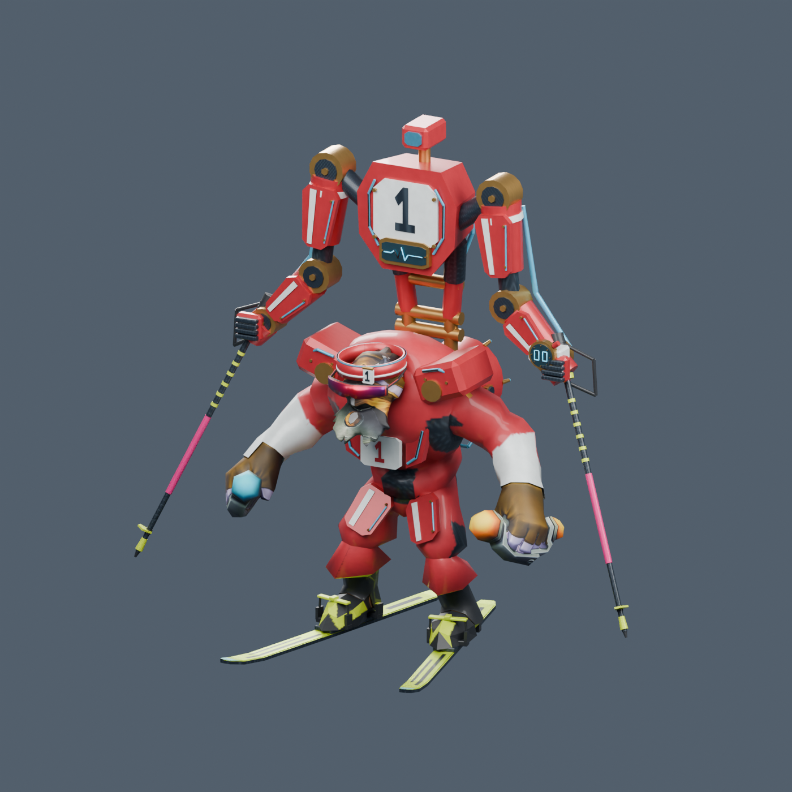

# The Polar Sprinter for Tinker

Dota 2 fan cosmetic, race gear revision 2026-10-28.

[Download the editable Blender files](https://github.com/yuichiromountainshiba/tinker-polar-sprinter/releases/tag/race-gear-2026-10-28)

The latest version has pink/carbon/yellow racing poles, black/yellow boots, slim red mirrored sunglasses, lime skis, a red racing outfit and the Snowmaker Pack.

## Blender files

The release ZIP contains both assembled masters and six individual editable item files, with packed textures and preview images.

- Open `polar_sprinter_with_skis.blend` for the complete six-piece fitted model.
- `polar_sprinter.blend` contains the five published-budget pieces without the provisional Boots accessory.
- `assets/` contains the six individual pieces with both LODs.

Created with Blender 4.2.3 LTS. Local source reopen, geometry, texture and skin-weight checks passed. Boots community slot support and Valve budgets, animation clearance, in-game materials and Workshop import remain unverified. Small jagged toe-panel edges and base-hero heel patches remain as closeup polish.

Private reference photographs are excluded. This is a fan project using Valve's Tinker reference; no ownership of Valve's underlying character assets is claimed.
